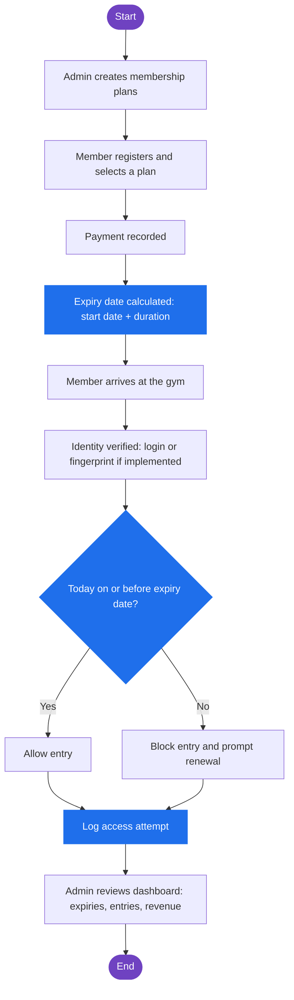
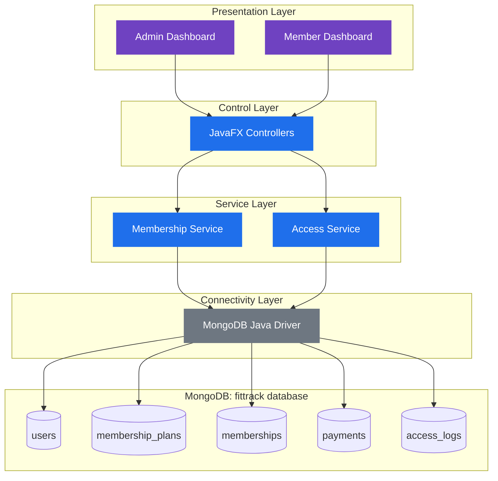

# Capstone-CP086-Varun & Sujan
# 💪 FitTrack

### Gym Membership and Access Management System

*Track every membership. Protect every renewal. Control every entry.*


---

**FitTrack** is a Java-based desktop application for managing gym memberships, payments, and entry control. It was built for **CP-086 (Gym Membership and Access Management System)** and replaces manual record keeping with a centralized digital platform. It gives gym owners reliable tracking of memberships and gives members a simple way to manage their own subscriptions.

> **Project status:** FitTrack is **in development**. This README describes the intended design and architecture. Features marked *planned* or *optional* are not claimed as implemented. Update the status notes as components are completed and verified.

---

## 📑 Table of Contents

1. [Overview and Problem Statement](#-overview-and-problem-statement)
2. [Core Features](#-core-features)
3. [Membership and Access Rules](#-membership-and-access-rules)
4. [How It Works](#-how-it-works)
5. [Technology Stack](#️-technology-stack)
6. [System Architecture](#️-system-architecture)
7. [Database Design](#️-database-design)
8. [Algorithms and Technical Concepts](#-algorithms-and-technical-concepts)
9. [Business Metrics](#-business-metrics)
10. [Security](#-security)
11. [Getting Started](#-getting-started)
12. [Future Enhancements](#-future-enhancements)
13. [Learning Outcomes](#-learning-outcomes)
14. [Contributing, License and Conclusion](#-contributing-license-and-conclusion)

---

## 📖 Overview and Problem Statement

### The problem

A gym owner loses revenue because **renewals are missed** and **attendance is not tracked**. Gyms that rely on notebooks or spreadsheets face recurring issues: payment records contain errors, expiries go unnoticed, and members with lapsed plans can still walk in.

### The proposed solution

FitTrack stores membership plans, registers members with a start date, and calculates expiry dates automatically. It verifies membership validity before granting entry, logs every access attempt, and gives the owner dashboards for expiring memberships, revenue, and active members. Data is stored in **MongoDB** as flexible documents.

### Objectives

| # | Objective |
|---|-----------|
| 1 | Digitize gym membership registration and management |
| 2 | Provide separate interfaces for administrators and members |
| 3 | Track membership validity and expiry dates automatically |
| 4 | Maintain payment and transaction records |
| 5 | Verify eligibility before granting access and keep entry logs |
| 6 | Provide membership statistics and revenue reports |
| 7 | Explore biometric (fingerprint) authentication for secure access |

---

## ✨ Core Features

The five compulsory CP-086 features are listed first, followed by supporting features.

### CP-086 core requirements

| # | Feature | Description |
|---|---------|-------------|
| 1 | **Membership plans** | Store plans (monthly, quarterly, annual) with duration and price |
| 2 | **Member registration** | Register members with a plan and start date; expiry is calculated automatically |
| 3 | **Expiry monitoring** | List members whose plan expires within 7 days |
| 4 | **Check-ins and access control** | Record daily check-ins and block expired members |
| 5 | **Reporting** | Show monthly revenue and the number of active members |

### Supporting features

| Area | Capabilities |
|------|--------------|
| **Member dashboard** | Registration and login, profile management, plan selection, renewal, payment history |
| **Admin dashboard** | Total members, active versus expired counts, member and plan management, payment review, entry history, revenue statistics |
| **Payment records** | Amounts, dates, transaction history, payments linked to memberships, revenue summaries |
| **Access management** | Identity verification, validity check, approve or reject, entry timestamps, access logs |

> Real online payments would require integration with a suitable payment gateway, which is **not** part of the current scope.

### Optional and stretch features

| Feature | Status |
|---------|--------|
| Fingerprint authentication | **Planned.** Depends on compatible hardware, SDK availability, and successful implementation |
| Trainer assignment and per-trainer member list | **Not implemented** (CP-086 stretch) |
| Membership freeze for up to 30 days | **Not implemented** (CP-086 stretch) |

---

## 📅 Membership and Access Rules

| Rule | Definition |
|------|------------|
| **Expiry date** | Start date + plan duration |
| **Active member** | Today is on or before the expiry date |
| **Expired member** | Today is after the expiry date |
| **Expiring soon** | Expiry date falls between today and today + 7 days |
| **Check-in decision** | Allowed only for active members; expired members are blocked |
| **Logging** | Every attempt, allowed or denied, is recorded with a timestamp |

> The 7-day alert window is a **configurable design decision** and can be changed to suit the gym's renewal process.

---

## 🔄 How It Works



### Step summary

1. An admin creates plans with a duration and price.
2. A member registers, chooses a plan and start date, and a payment is recorded.
3. The system calculates the expiry date and membership status.
4. At the gym, the member's identity is verified.
5. The Access Service checks validity, allows or blocks entry, and logs the attempt.
6. The admin monitors expiries, entry history, active members, and revenue.

---

## 🛠️ Technology Stack

| Technology | Purpose |
|------------|---------|
| **Java 17+** | Application logic |
| **JavaFX** | Desktop user interface |
| **JavaFX CSS** | UI styling |
| **MongoDB** | Document database for persistent data storage |
| **MongoDB Java Driver (Sync)** | Connects the Java application to MongoDB and runs queries |
| **Maven** | Dependency and build management |
| **Git** | Version control |
| **GitHub** | Source code hosting |
| **Biometric SDK** | Fingerprint integration, **only if implemented** |

---

## 🏗️ System Architecture

FitTrack uses a layered design that separates interface, business rules, and data access.

| Layer | Component | Responsibility |
|-------|-----------|----------------|
| Presentation | Admin Dashboard, Member Dashboard | User interaction |
| Control | JavaFX Controllers | Handle UI events and call services |
| Business Logic | Membership Service | Plans, registration, expiry, renewal, revenue |
| Business Logic | Access Service | Eligibility check, allow or block, access logging |
| Connectivity | MongoDB Java Driver | Queries, updates, and aggregation pipelines |
| Persistence | MongoDB | Users, Memberships, Payments, Access Logs |



> This diagram shows the **intended architecture**. It has not been verified against a completed implementation.

---

## 🗄️ Database Design

FitTrack uses **MongoDB**, a document database. The structure below is a **suggested design**; adjust field names to match your final implementation. Data is grouped into collections instead of relational tables, and related data is linked by `ObjectId` references.

| Collection | Purpose | Key fields |
|------------|---------|------------|
| `users` | Admins and members | `_id`, `name`, `email`, `phone`, `passwordHash`, `role` |
| `membership_plans` | Plan catalogue | `_id`, `name`, `durationDays`, `price` |
| `memberships` | A member's subscription | `_id`, `userId`, `planId`, `planSnapshot`, `startDate`, `expiryDate` |
| `payments` | Money received | `_id`, `membershipId`, `userId`, `amount`, `paymentDate` |
| `access_logs` | Entry attempts | `_id`, `userId`, `attemptTime`, `allowed`, `reason` |

### Example documents

```json
// users
{
  "_id": { "$oid": "665f00000000000000000001" },
  "name": "Asha Rao",
  "email": "asha@example.com",
  "phone": "9XXXXXXXXX",
  "passwordHash": "<hashed-password>",
  "role": "MEMBER"
}

// membership_plans
{
  "_id": { "$oid": "665f00000000000000000010" },
  "name": "Quarterly",
  "durationDays": 90,
  "price": 4500
}

// memberships
{
  "_id": { "$oid": "665f00000000000000000020" },
  "userId": { "$oid": "665f00000000000000000001" },
  "planId": { "$oid": "665f00000000000000000010" },
  "planSnapshot": { "name": "Quarterly", "durationDays": 90, "price": 4500 },
  "startDate": { "$date": "2026-10-01T00:00:00Z" },
  "expiryDate": { "$date": "2026-12-30T00:00:00Z" }
}

// payments
{
  "_id": { "$oid": "665f00000000000000000030" },
  "membershipId": { "$oid": "665f00000000000000000020" },
  "userId": { "$oid": "665f00000000000000000001" },
  "amount": 4500,
  "paymentDate": { "$date": "2026-10-01T00:00:00Z" }
}

// access_logs
{
  "_id": { "$oid": "665f00000000000000000040" },
  "userId": { "$oid": "665f00000000000000000001" },
  "attemptTime": { "$date": "2026-10-14T06:30:00Z" },
  "allowed": true,
  "reason": "Active membership"
}
```

> The example data above is illustrative only. The comments (`// ...`) are for readability and are not valid JSON.

### Design decisions

| Decision | Reason |
|----------|--------|
| **Plan snapshot inside `memberships`** | Keeps a member's price and duration unchanged even if the plan is edited later |
| **Separate `payments` collection** | Payments grow over time and are aggregated by date for revenue reports |
| **Separate `access_logs` collection** | Logs grow quickly and should not bloat membership documents |
| **References using `ObjectId`** | Links documents without duplicating user data |
| **Dates stored as BSON dates** | Enables correct range queries and sorting |

### Suggested indexes

```javascript
db.users.createIndex({ email: 1 }, { unique: true })
db.memberships.createIndex({ userId: 1 })
db.memberships.createIndex({ expiryDate: 1 })
db.payments.createIndex({ paymentDate: 1 })
db.access_logs.createIndex({ userId: 1, attemptTime: -1 })
```

> Whether a membership is currently active should be **calculated from `expiryDate` and the current date**, not trusted from a stored flag, because a stored status can become stale.

---

## 🧠 Algorithms and Technical Concepts

| Concept | Application in FitTrack |
|---------|-------------------------|
| **Date arithmetic** | Expiry = start date + plan duration |
| **Rule-based access control** | Entry depends on whether the membership is active |
| **Range filtering** | "Expiring soon" selects expiry dates within the next 7 days |
| **Aggregation pipeline** | Monthly revenue as a sum of payments; active members as a distinct count |
| **CRUD operations** | Manage users, plans, memberships, and payments |
| **Audit logging** | Record every allowed and denied entry attempt |
| **Indexing** | Speeds up expiry, payment-date, and log lookups |
| **Layered design** | Controllers, services, and the database driver kept separate |

### Core logic (pseudocode)

```text
expiryDate = startDate + plan.durationDays

isActive   = (today <= expiryDate)

expiringSoon = (today <= expiryDate) and (expiryDate <= today + 7 days)

on check-in:
    if isActive: allow, log(allowed = true)
    else:        block, log(allowed = false, reason = "Membership expired")
```

### Edge cases to handle

- The **expiry day itself** counts as active.
- Month-end and leap-year arithmetic when durations are expressed in months.
- **Time zones:** MongoDB stores dates in UTC, so decide whether expiry is compared by calendar day in the gym's local time zone.
- Renewals before expiry, which should extend from the current expiry rather than from today.

---

## 📊 Business Metrics

| Metric | Definition |
|--------|------------|
| **Monthly revenue** | Sum of `payments.amount` where `paymentDate` falls within the chosen calendar month |
| **Active members** | Count of distinct `userId` values with a membership where `expiryDate >= today` |
| **Expiring soon** | Members whose active membership expires within the next 7 days |

### Example queries (mongosh)

```javascript
// Monthly revenue for October 2026
db.payments.aggregate([
  { $match: {
      paymentDate: {
        $gte: ISODate("2026-10-01T00:00:00Z"),
        $lt:  ISODate("2026-11-01T00:00:00Z")
      }
  }},
  { $group: { _id: null, monthlyRevenue: { $sum: "$amount" } } }
])

// Number of currently active members
db.memberships.aggregate([
  { $match: { expiryDate: { $gte: new Date() } } },
  { $group: { _id: "$userId" } },
  { $count: "activeMembers" }
])

// Memberships expiring within 7 days
db.memberships.find({
  expiryDate: {
    $gte: new Date(),
    $lte: new Date(Date.now() + 7 * 24 * 60 * 60 * 1000)
  }
})
```

> If the monthly revenue query returns no document, no payments were made that month, so report revenue as 0.

> **Revenue and active members are different measures.** Revenue counts money received in a period, while active members counts people with valid plans today. A large annual payment raises revenue in one month but keeps the member active for twelve.

---

## 🔐 Security

| Area | Approach |
|------|----------|
| **Role separation** | Administrators and members see different interfaces and permissions |
| **Password storage** | Store salted hashes (for example BCrypt), never plain text |
| **Query safety** | Build queries with the driver's `Filters` helpers and typed values; never concatenate raw user input into query documents |
| **Database access** | Enable MongoDB authentication and use a least-privilege database user |
| **Credentials** | Keep the connection string and passwords out of source control |
| **Biometric data** | If fingerprint support is built, follow the SDK vendor's guidance and avoid storing raw biometric images |

> The measures above are the **intended practices**. Verify each against the final code before describing it as implemented.

---

## 🚀 Getting Started

> Replace all placeholders in angle brackets with your actual details.

### Prerequisites

- JDK 17 or later
- Apache Maven 3.8+
- MongoDB Community Server (local) or a MongoDB Atlas cluster
- `mongosh` (MongoDB Shell) for database setup
- Git
- An IDE with Java and JavaFX support

### 1. Clone the repository

```bash
git clone https://github.com/<your-username>/<your-repository>.git
cd <your-repository>
```

### 2. Start MongoDB

Make sure the MongoDB server is running, then connect with the shell:

```bash
mongosh "mongodb://localhost:27017"
```

### 3. Create the database and indexes

MongoDB creates collections on first use, but creating indexes up front is recommended:

```javascript
use fittrack

db.users.createIndex({ email: 1 }, { unique: true })
db.memberships.createIndex({ userId: 1 })
db.memberships.createIndex({ expiryDate: 1 })
db.payments.createIndex({ paymentDate: 1 })
db.access_logs.createIndex({ userId: 1, attemptTime: -1 })
```

### 4. Add the MongoDB driver to Maven

Add the synchronous Java driver to `pom.xml`, using the current version from the official MongoDB documentation:

```xml
<dependency>
    <groupId>org.mongodb</groupId>
    <artifactId>mongodb-driver-sync</artifactId>
    <version>&lt;latest-driver-version&gt;</version>
</dependency>
```

### 5. Configure the database connection

Set your connection details in the project's configuration location (for example `src/main/resources/application.properties` or a constants class):

```properties
mongodb.uri=mongodb://localhost:27017
mongodb.database=fittrack
```

For a database with authentication or an Atlas cluster, use the connection string provided by your deployment:

```properties
mongodb.uri=mongodb://<username>:<password>@<host>:27017/?authSource=<auth-database>
```

> Do not commit real credentials. Add the configuration file to `.gitignore` if it contains secrets.

### 6. Build and run

```bash
mvn clean install
mvn javafx:run
```

`mvn javafx:run` assumes the JavaFX Maven plugin is configured in `pom.xml`. If you use a different run method, replace this step with the one your project uses.

---

## 🔭 Future Enhancements

| Enhancement | Description |
|-------------|-------------|
| Fingerprint authentication | Integrate a compatible scanner and SDK for biometric entry |
| Payment gateway | Accept real online payments |
| Expiry notifications | Email or SMS reminders before a plan lapses |
| Trainer assignment | Assign trainers and list each trainer's members (CP-086 stretch) |
| Membership freeze | Pause a membership for up to 30 days and extend expiry (CP-086 stretch) |
| Attendance analytics | Visit frequency, peak hours, and inactive members using aggregation pipelines |
| Reports and charts | Exportable and visual revenue and membership reports |
| Multi-document transactions | Make registration and payment atomic (requires a MongoDB replica set) |

---

## 🎓 Learning Outcomes

| Area | Concept demonstrated |
|------|----------------------|
| Layered architecture | Separation of UI, controllers, services, and data access |
| NoSQL data modelling | Collections, references, and snapshots in a document database |
| MongoDB and Java | Using the MongoDB Java Driver for CRUD, filtering, and aggregation |
| Indexing | Choosing indexes for common query patterns |
| Date handling | Expiry calculation, UTC storage, boundary cases, and range queries |
| Access rules | Turning business rules into testable conditions |
| Business reporting | Monthly aggregation and the difference between revenue and active members |
| Desktop UI | Building role-based screens with JavaFX |
| Engineering practice | Maven builds, Git workflow, and honest status documentation |

---

## 🤝 Contributing, License and Conclusion

### Contributing

1. Fork the repository.
2. Create a feature branch: `git checkout -b feature/<short-description>`
3. Commit with a clear message: `git commit -m "Add <feature>"`
4. Push the branch and open a pull request describing your changes.

### Contributors

- `<Your Name>` — `<your GitHub profile link>`

### License

Select an appropriate open-source license (for example MIT or Apache 2.0) and add it as a `LICENSE` file in the repository root. Update this section once chosen.

### Conclusion

FitTrack turns scattered membership records into a clear, reliable system: fewer missed renewals, tracked attendance, and visible revenue.

**Every member tracked. Every renewal protected.**
