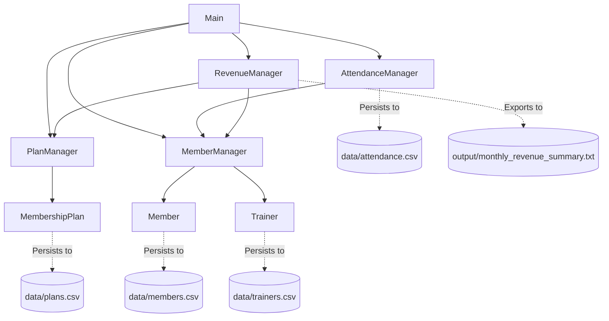

# Capstone-CP086-Varun & Sujan
# 💪 FitTrack – Gym Membership and Access Management System

*Track every membership. Protect every renewal. Control every entry.*


---

**FitTrack** is a modular, professional Java console application developed for **CP-086 (Gym Membership and Access Management System)**. It automates manual gym record keeping, eliminates missed renewals, controls gym entry through automated access checks, and gives gym owners clear monthly financial metrics.

Collaboratively developed by **Varun Pandey** & **Sujan Khadka** using **VS Code** and **GitHub**.

---

## 📑 Table of Contents

1. [Project Overview](#-project-overview)
2. [Project Structure](#-project-structure)
3. [Core & Stretch Features](#-core--stretch-features)
4. [Access Control and Membership Rules](#-access-control-and-membership-rules)
5. [Architecture & OOP Principles](#-architecture--oop-principles)
6. [Data Storage & CSV Schemas](#-data-storage--csv-schemas)
7. [Prerequisites & Requirements](#-prerequisites--requirements)
8. [Execution Instructions](#-execution-instructions)
9. [Automated Testing & Verification](#-automated-testing--verification)
10. [Collaborative Development](#-collaborative-development)

---

## 📖 Project Overview

Gym owners often lose revenue because **membership renewals are missed** and **attendance is not controlled**. Gyms relying on paper registers or scattered spreadsheets face recurring issues:
* Expiry dates go unnoticed, allowing expired members to access facilities.
* Financial metrics and monthly income are difficult to aggregate and audit.
* Member records can be lost or overwritten easily.

### The Solution: FitTrack
FitTrack provides a menu-driven, modular console solution with persistent CSV storage:
1. **Stores and manages membership plans** with custom durations and pricing.
2. **Registers members with automated expiry calculation** based on selected plan terms.
3. **Monitors membership expiry** with proactive 7-day expiration alerts.
4. **Enforces strict access control during check-in**, automatically rejecting expired and frozen memberships.
5. **Calculates monthly revenue breakdowns and active member metrics**, exporting summary reports.
6. **Includes stretch capabilities**: personal trainer assignments and membership freezing (up to 30 days) with automated expiry extension.

---

## 📁 Project Structure

```text
FitTrack/
│
├── Main.java               # Console menu interface and application orchestrator
├── MembershipPlan.java     # Plan entity model with validation & CSV serialization
├── Member.java             # Member entity model with expiry & freeze algorithms
├── Trainer.java            # Trainer entity model with specializations
├── PlanManager.java        # Manages plan catalogue and data/plans.csv
├── MemberManager.java      # Manages member records, trainers, and data/members.csv
├── AttendanceManager.java  # Check-in logging, automated access blocking & CSV records
├── RevenueManager.java     # Monthly revenue calculations & text report generator
├── TestFitTrack.java       # Comprehensive automated test suite verifying all features
│
├── data/
│   ├── plans.csv           # Persistent catalogue of membership plans
│   ├── members.csv         # Persistent member records and statuses
│   ├── attendance.csv      # Persistent timestamped check-in logs
│   └── trainers.csv        # Persistent certified trainers catalogue
│
├── output/
│   └── monthly_revenue_summary.txt  # Generated monthly financial and member summary
│
├── README.md               # Complete project documentation and execution guide
└── .gitignore              # Ignores compiled bytecodes and editor artifacts
```

---

## ✨ Core & Stretch Features

### 1. Membership Plan Management (Compulsory)
* Create, catalogue, and view gym membership plans.
* Stores unique Plan ID, Plan Name, Duration (in months), and Price.
* Persisted in `data/plans.csv`. Pre-loaded with default Monthly, Quarterly, Half-Yearly, and Annual plans.

### 2. Member Registration (Compulsory)
* Registers new gym members with Name, Contact number, selected Plan, and Start Date.
* **Auto-generated Unique Member IDs** (`M1001`, `M1002`, ...).
* **Automatic Expiry Calculation**: `ExpiryDate = StartDate.plusMonths(Plan.Duration)`.
* Changes are automatically persisted to `data/members.csv`.

### 3. Membership Expiry Tracking (Compulsory)
* **7-Day Expiry Alert**: Lists members expiring within the next 7 days so gym owners can proactively reach out for renewals.
* **Expired Members Filter**: Lists members whose plans have lapsed.
* **Active Members Filter**: Displays currently valid, non-frozen gym members.

### 4. Attendance Management & Access Control (Compulsory)
* Records daily member check-ins with exact date and time timestamps.
* **Automated Access Enforcement**:
  * If a member is **EXPIRED** $\rightarrow$ Immediately blocks entry, logs `BLOCKED_EXPIRED`, and alerts the operator.
  * If a member is **FROZEN** $\rightarrow$ Blocks entry, logs `BLOCKED_FROZEN`.
  * If a member is **ACTIVE** $\rightarrow$ Grants entry, logs `GRANTED`, and warns if expiry is within 7 days.
* Displays formatted attendance logs table and persists logs to `data/attendance.csv`.

### 5. Revenue & Active Members Summary (Compulsory)
* Computes total lifetime revenue and monthly income breakdown grouped by registration month.
* Computes active member counts, percentage of total membership, and average revenue per member.
* Generates on-screen dashboard and exports summary to `output/monthly_revenue_summary.txt`.

### 6. Trainer Management (Stretch Feature)
* Catalogues personal trainers with specialized fitness domains and contact info.
* Allows assigning personal trainers to members.
* Filter and display all members assigned to any selected trainer.

### 7. Membership Freezing (Stretch Feature)
* Allows members to freeze their membership for **up to 30 days**.
* **Automated Expiry Adjustment**: Pushes the member's expiry date forward by the exact number of frozen days.
* Prevents check-in while frozen and supports seamless unfreezing.

---

## 📅 Access Control and Membership Rules

| Rule | Definition & Implementation |
|---|---|
| **Expiry Calculation** | `startDate.plusMonths(plan.durationMonths)` |
| **Active Member** | `currentDate <= expiryDate && !isFrozen` |
| **Expired Member** | `currentDate > expiryDate` |
| **Expiring Soon** | `currentDate <= expiryDate && expiryDate <= currentDate.plusDays(7)` |
| **Check-In Decision** | Granted only for active members. Expired or frozen members are automatically rejected. |
| **Freeze Policy** | Allowed between 1 and 30 days for active memberships. Expiry extended by freeze duration. |

---

## 🏗️ Architecture & OOP Principles



### Applied OOP Principles:
1. **Single Responsibility Principle (SRP)**:
   * `MembershipPlan`, `Member`, `Trainer`: Pure entity domain models.
   * `PlanManager`: Exclusive management of plan storage and catalogue.
   * `MemberManager`: Manages member lifecycle, trainer relationships, and freezing.
   * `AttendanceManager`: Access control logic and check-in logging.
   * `RevenueManager`: Financial computations and report exports.
   * `Main`: Console presentation layer and user input handling.
2. **Encapsulation**:
   * Private fields with controlled getters, setters, and validation methods.
   * Safe CSV parsing with string escaping to prevent delimiter corruption.
3. **Data Integrity & Immutability**:
   * Synchronized manager methods to prevent race conditions during updates.
   * Unique ID generation algorithms scanning max existing IDs.

---

## 🗄️ Data Storage & CSV Schemas

### 1. `data/plans.csv`
```csv
planId,name,durationMonths,price
P01,Monthly Standard,1,49.99
P02,Quarterly Pro,3,129.99
P03,Half-Yearly Elite,6,229.99
P04,Annual Ultimate,12,399.99
```

### 2. `data/members.csv`
```csv
memberId,name,contact,planId,planName,startDate,expiryDate,assignedTrainerId,isFrozen,freezeStartDate,frozenDays
M1001,Alex Smith,555-1001,P04,Annual Ultimate,2026-09-15,2027-09-15,T01,false,,0
M1002,Sarah Connor,555-1002,P01,Monthly Standard,2026-10-19,2026-11-19,T02,false,,0
M1003,Mike Tyson,555-1003,P01,Monthly Standard,2026-09-15,2026-11-10,T01,false,,0
M1004,Alice Cooper,555-1004,P02,Quarterly Pro,2026-10-15,2027-01-29,T03,true,2026-11-13,14
```

### 3. `data/attendance.csv`
```csv
recordId,memberId,memberName,timestamp,status,remarks
A1001,M1001,Alex Smith,2026-11-15 09:46:48,GRANTED,Access Approved - Active Annual Plan
A1004,M1003,Mike Tyson,2026-11-15 13:46:48,BLOCKED_EXPIRED,DENIED: Membership expired on 2026-11-10. Please renew plan.
```

### 4. `data/trainers.csv`
```csv
trainerId,name,specialization,contact
T01,Marcus Vance,Strength & Conditioning,555-0101
T02,Elena Rostova,Yoga & Flexibility,555-0102
T03,David Kim,HIIT & Cardio,555-0103
```

---

## 🛠️ Prerequisites & Requirements

* **Java Development Kit (JDK)**: Version 17 or higher (tested with JDK 23).
* **IDE**: Visual Studio Code (with "Extension Pack for Java") or any standard terminal.
* **Operating System**: macOS, Windows, or Linux.

---

## 🚀 Execution Instructions

### Running in VS Code
1. Open the project folder (`Capstone-CP086-Varun`) in VS Code.
2. Ensure the **Extension Pack for Java** is installed.
3. Open `Main.java` and click the **Run** button above `public static void main(String[] args)` (or press `F5`).
4. Interact directly using the integrated terminal!

### Running from Terminal
```bash
# 1. Navigate to the project root directory
cd Capstone-CP086-Varun

# 2. Compile all Java source files
javac *.java

# 3. Launch the FitTrack console application
java Main
```

---

## 🧪 Automated Testing & Verification

An automated test suite is included in `TestFitTrack.java` to verify all compulsory and stretch features without manual input:

```bash
# Compile and run the test suite
javac TestFitTrack.java
java TestFitTrack
```

### Verified Test Cases:
* [x] **Test 1**: Plan creation, retrieval, duplicate ID prevention, and persistence.
* [x] **Test 2**: Member registration, unique ID generation, and automatic expiry calculation.
* [x] **Test 3**: Expiry monitoring (filtering active, expired, and members expiring in $\le 7$ days).
* [x] **Test 4**: Access control enforcement (**strictly blocking** expired and frozen members; granting active members).
* [x] **Test 5**: Monthly and lifetime revenue calculation, metric aggregation, and report generation in `output/`.
* [x] **Test 6**: Trainer assignment and querying members by trainer.
* [x] **Test 7**: Membership freezing (1-30 days), automatic expiry extension, and unfreezing.
* [x] **Test 8**: Persistence reliability across application restarts.

---

## 👥 Collaborative Development

Developed collaboratively for **Capstone Project CP-086**:
* **Varun Pandey** (`pandeyvarun2006@gmail.com`)
* **Sujan Khadka** ('khadkasujan952@gmail.com')

### Contribution Guidelines:
1. Always pull latest changes before starting work: `git pull origin main`.
2. Keep code modular and adhere to the established package structure.
3. Run `java TestFitTrack` before committing to verify all test cases pass.
4. Do not commit `.class` files (handled via `.gitignore`).
